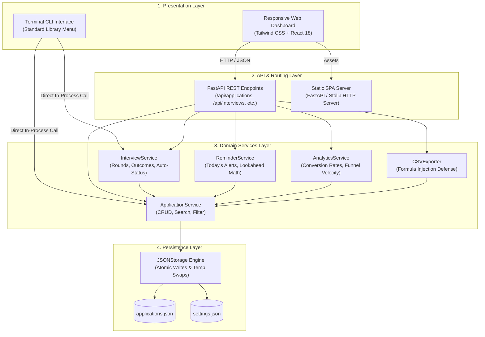

# JobTrack Pro — System Architecture & Responsive Design Guide

## 1. Executive Summary

**JobTrack Pro** is a personal job application tracker and interview pipeline management system. It provides a full-stack platform consisting of:
1. **Responsive Web Dashboard**: Mobile, tablet, and desktop adaptive Single-Page Application (SPA) built with HTML5, Tailwind CSS, and React 18.
2. **RESTful Web API**: Asynchronous API built with FastAPI, Pydantic, and Uvicorn.
3. **Interactive CLI Engine**: Zero-dependency offline terminal menu interface running purely on Python's Standard Library.
4. **Resilient Data Storage**: Atomic JSON file persistence with automatic corruption recovery and spreadsheet-safe CSV exports.

---

## 2. 4-Tier Architecture Overview

The system adheres to a **Clean 4-Tier Architecture**, ensuring clear separation of concerns, testability, and maintainability:



---

## 3. Layer Breakdown

### Tier 1: Presentation Layer
- **Responsive Dashboard (`frontend/index.html`, `frontend/app.jsx`, `frontend/styles.css`)**:
  - **Dynamic Theme Engine**: Light and Dark mode with instant localStorage synchronization and OS preference detection.
  - **Mobile-First Layout**:
    - **Desktop (>= 1024px)**: Fixed 256px sidebar, candidate avatar badge, full statistics grid, and data tables.
    - **Tablet (640px - 1023px)**: Responsive 2-column KPI grid, adaptable search bar, and slide-out navigation.
    - **Mobile (< 640px)**: Slide-out drawer with dark overlay, sticky bottom navigation bar with badge counters, touch-optimized cards, and mobile-friendly modals.
  - **View Modes**: One-click toggle between **Cards View** (card-based view ideal for touch screens) and **Table View** (spacious tabular layout with sort/filter).
- **Terminal CLI (`main.py`)**:
  - Interactive menu interface with zero external dependencies.
  - Complete support for adding, viewing, updating, deleting applications, scheduling interviews, recording outcomes, viewing alerts, and exporting CSVs.

### Tier 2: API & Routing Layer (`server.py`)
- **FastAPI Framework**: High-performance asynchronous REST API with auto-generated interactive documentation at `/docs` (Swagger UI) and `/redoc` (ReDoc).
- **CORS Middleware**: Pre-configured cross-origin resource sharing.
- **Dual Server Mode**:
  - **Production Mode (FastAPI + Uvicorn)**: Full REST API, file persistence, and live data synchronization.
  - **Zero-Install Fallback Mode (Python Standard Library HTTP Server)**: Automatically serves the responsive web dashboard on `http://localhost:8000` with built-in interactive demo data if dependencies are not yet installed.

### Tier 3: Domain Services Layer (`src/services/`, `src/reports/`)
- **`ApplicationService`**:
  - Manages job application lifecycles.
  - Case-insensitive search across company name, role, location, status, and candidate name.
  - Multi-attribute filtering (status, employment type, salary, date ranges).
- **`InterviewService`**:
  - Manages interview rounds (Technical, Screening, System Design, Behavioral, Final).
  - Automatically updates application status to `Interview` when a round is scheduled.
  - Records interview outcomes (`Passed`, `Failed`, `Offer Received`, `Pending`).
- **`ReminderService`**:
  - Computes upcoming interviews scheduled for today.
  - Identifies deadlines approaching within a configurable window (3, 7, 14, 30 days).
  - Highlights past-due applications requiring follow-up.
- **`AnalyticsService`**:
  - Calculates conversion rates: Application-to-Interview %, Interview-to-Offer %, and Overall Offer %.
  - Safe zero-division handling for empty or early-stage pipelines.
- **`CSVExporter`**:
  - Generates RFC 4180-compliant CSV files.
  - Disarms spreadsheet formula injection by sanitizing cells starting with `=`, `+`, `-`, or `@`.

### Tier 4: Storage & Persistence Layer (`src/storage/`)
- **`JSONStorage`**:
  - Atomic persistence using temporary file writing followed by atomic file replacement (`os.replace`).
  - Guards against corrupted JSON files and power loss during writes.
  - Recovers gracefully from partial corruption without wiping valid records.

---

## 4. Responsive Design System & Breakpoints

| Breakpoint | Target Devices | Navigation Pattern | Layout Strategy |
| :--- | :--- | :--- | :--- |
| **Mobile (`< 640px`)** | iPhone, Android Phones | Sticky Bottom Bar + Slide-out Drawer | 1-column KPI grid, Card View for applications, touch-friendly full-screen modals |
| **Tablet (`640px - 1023px`)** | iPad, Tablets, Small Laptops | Hamburger Button + Slide-out Drawer | 2-column KPI grid, compact table or card grid, adaptive header |
| **Desktop (`>= 1024px`)** | Laptops, Desktop Monitors | Persistent 256px Sidebar Navigation | 4-column KPI grid, full data table, right-side detail drawer |

---

## 5. Simplified Project Directory Structure

```text
JobTrack/
├── server.py              # Root launcher for Web Dashboard & REST API
├── main.py                # Root launcher for Terminal CLI
├── requirements.txt       # Project dependencies
├── README.md              # Getting started guide
├── ARCHITECTURE.md        # Architectural reference & responsive design specs
└── JobTrack/
    └── JobTrack/
        ├── frontend/      # Web Dashboard assets
        │   ├── index.html # HTML5 shell with dark-mode script
        │   ├── app.jsx    # Responsive React 18 application
        │   └── styles.css # Tailwind & glassmorphism utilities
        ├── src/           # Domain business logic & models
        │   ├── models/    # Domain data models & enums
        │   ├── reports/   # CSV exporter
        │   ├── services/  # Application, Interview, Reminder, & Analytics services
        │   ├── storage/   # Atomic JSON storage engine
        │   └── utils/     # Date math and input validators
        ├── data/          # Persistent data storage (JSON files)
        ├── exports/       # Generated CSV export files
        └── tests/         # Exhaustive unit & integration test suites
```

